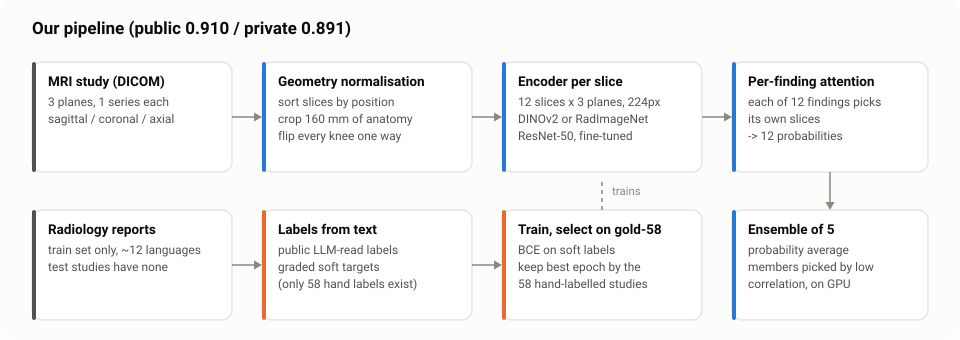
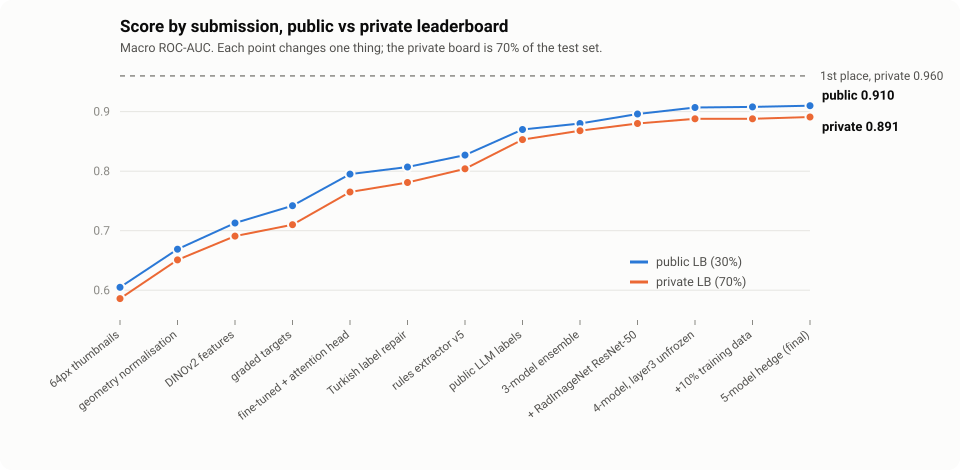
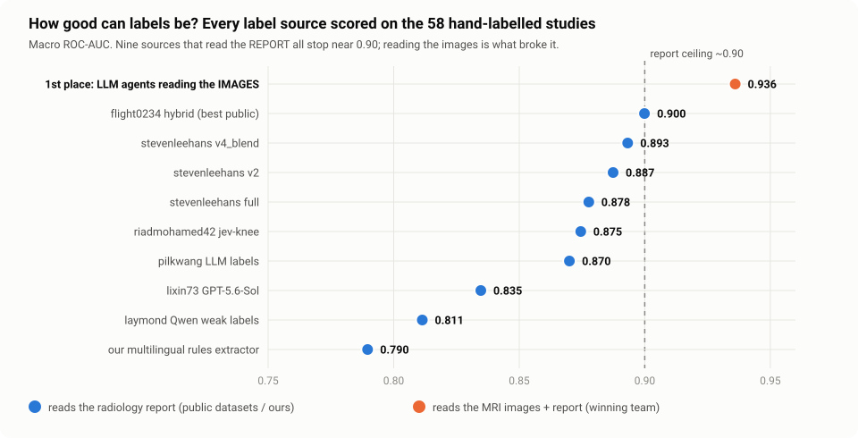

# RSNA 2026 Knee Abnormality Detection — an independent pipeline

Code and write-up for an entry in the Kaggle **RSNA 2026 Knee Abnormality
Detection** competition: predict 12 findings (ACL tear, meniscal tears,
osteoarthritis, effusion, fracture, …) from a knee MRI study.

Built from scratch rather than forked. **Final: 0.891 private / 0.910 public**
(macro ROC-AUC), rank 4,340 of 6,425.



## How it works, briefly

**The catch in this competition:** only **58** of 4,407 training studies have
the 12 answers. The rest come with a written radiology report, in about 12
languages, and the test studies have no report at all.

1. **Labels from text.** Turn each report into 12 graded scores — first with a
   multilingual rules extractor, later with public LLM-read labels. These are
   the training targets.
2. **Make every knee comparable.** Sort slices by their real position, crop the
   same 160 mm of anatomy from every scan, and flip left knees so all knees
   face the same way. This alone was worth +0.036.
3. **Read each slice with a pretrained network** (DINOv2, or a ResNet-50
   pretrained on radiology images), fine-tuned on our labels.
4. **Let each finding pick its own slices.** An attention head gives each of the
   12 findings its own view over the 36 slices, since a ligament tear and a
   fluid collection show up in different places.
5. **Average five models** chosen for making *different* mistakes, not for being
   individually best, under the 9-hour inference limit.

Every change was chosen on the 58 hand-labelled studies and confirmed on the
leaderboard. Public and private scores moved together at every step:



## The central finding

Every label source that reads the **report** — nine of them, including ours —
stops near 0.90 on the hand-labelled studies, because the hand labels were made
from the **images** and reports leave things out. The winning team broke that
ceiling by having LLM agents read the images themselves:



**[`WRITEUP.md`](WRITEUP.md)** has the full story: ~30 measured experiments,
the negative results with numbers, infrastructure lessons, and an honest
comparison with the winning solution.

## Layout

```
WRITEUP.md            the full write-up
assets/               figures (generated by tools/make_figures.py from our own numbers)
src/                  local analysis: label extraction, scoring, ensemble search,
                      teacher comparison, retrieval experiments, Eikonal solver,
                      topology / persistent-homology descriptors
kaggle/<kernel>/      one directory per Kaggle kernel: <name>.py + kernel-metadata.json
  cache_*             decode DICOM once into uint8 slice caches
  finetune_*          training runs (each one a matched experiment with a fixed seed)
  valpreds_*          validation predictions consumed by the ensemble search
  submit_*            submission kernels (offline; CPU and GPU variants)
tools/                ship src/ modules to Kaggle; regenerate the figures
```

## What is not here, and why

- **Competition data and anything derived from it** — MRI images, `train.csv`
  (which contains the reports), extracted label files, cached arrays, kernel
  outputs. The competition rules do not permit redistributing them, which is
  also why the figures are charts and diagrams rather than MRI slices.
- **Trained weights.** Large, and regenerable from the kernels.

## Reproducing

Everything runs as Kaggle kernels. The general pattern:

```bash
# local analysis (Python 3.11)
pip install -r requirements.txt
python src/extract_rules.py rules_v5        # reports -> 12 graded labels (needs competition data in data/)
python src/evaluate.py rules_v5             # score an extractor on the 58 gold studies
python src/ensemble_cost_search.py          # best ensemble that fits the 9 h cap
python tools/make_figures.py assets         # regenerate the figures

# Kaggle (edit the "id" in each kernel-metadata.json to your own username first)
python tools/sync_utility.py --push         # ship src/ modules as a private dataset
kaggle kernels push -p kaggle/cache_slices  # then finetune_*, valpreds_*, submit_*
```

Each kernel's docstring states what it tests, its matched control, and the
result it produced. Kernels assert on their own inputs (cache shape, the gold
score recorded inside each checkpoint, label coverage) rather than trusting file
names, because several silent staleness bugs were caught that way.

## License

MIT for the code in this repository. Pretrained weights used by the kernels
(DINOv2, RadImageNet, MedImageInsight) and public label datasets keep their own
licenses.
